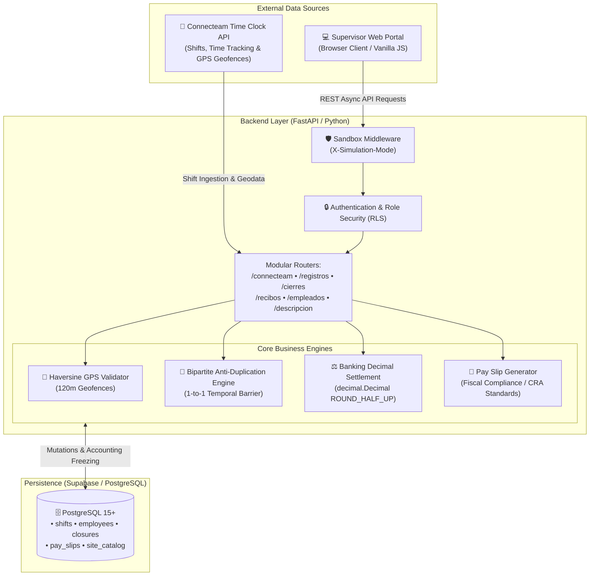

  # 💼 CaroníPay — Enterprise Payroll, Attendance & GPS Verification System
  ### Solución Empresarial en Producción Activa · Liquidación Contable · Cumplimiento Fiscal y Laboral
  ### Active Enterprise Production Solution · Accounting Settlement · Labor & Tax Compliance

  

    <a href="#-español"><b>🇪🇸 Versión en Español</b></a>
    &nbsp;•&nbsp;
    <a href="#-english"><b>🇬🇧 English Version</b></a>
  

  

    
    
    
  

  

    
    
    
    
    
    
  

---

## 🇪🇸 Versión en Español

> [!NOTE]
> **Aviso de Privacidad y Confidencialidad Comercial:**  
> Este repositorio funciona como **vitrina arquitectónica y demostración técnica pública** de una plataforma real actualmente en uso corporativo. Para proteger la confidencialidad de la empresa cliente, datos de colaboradores y credenciales de infraestructura, el código fuente privado y las bases de datos de producción residen en un repositorio protegido bajo acuerdo de confidencialidad comercial (NDA).

### 🌟 Visión General del Proyecto

**CaroníPay (Sistema de Nómina 5.0)** es una plataforma web integral de gestión operativa y liquidación de nómina empresarial desarrollada a medida para una empresa de servicios comerciales y corporativos.

El sistema resuelve la complejidad del control de personal itinerante con turnos fragmentados, dispersión horaria en decenas de sedes de clientes, validación de fichajes mediante geocercas GPS, auditoría anti-duplicidad de marcas de tiempo y generación automatizada de recibos de pago formales (*Talons de paie*) bajo estricto cumplimiento de la normativa fiscal y laboral aplicable.

### 🚀 Desafíos Operativos Resueltos

| Desafío Operativo | Solución Implementada en el Sistema |
| :--- | :--- |
| **Turnos Fragmentados y Múltiples Sedes** | Motor multi-tarifa capaz de procesar pagos por hora, montos fijos y tarifas por contrato de visita en un mismo día. |
| **Validación de Fichajes y Asistencia** | Validación GPS estricta: la sede de trabajo se verifica mediante la fórmula de Haversine contra las coordenadas de entrada dentro de una tolerancia de 120 metros. |
| **Colisión y Duplicidad de Turnos Editados** | Motor matemático de correspondencia bipartita 1-a-1 con barrera temporal que evita pisar turnos continuos o re-importar marcas ya procesadas. |
| **Cumplimiento de Legislación Laboral** | Automatización de reglas laborales: descuento de descanso no remunerado condicionado a jornadas continuas $\ge 5$ horas, aplicado a lo sumo una sola vez al día. |
| **Precisión Financiera sin Fugas de Centavos** | Motor de liquidación aritmética con `decimal.Decimal` en Python y redondeo bancario estándar `ROUND_HALF_UP`. |
| **Emisión Fiscal de Comprobantes** | Generación e impresión de *Talons de Paie* con leyendas legales obligatorias de exención fiscal para pequeños proveedores. |

### 🛠️ Arquitectura del Sistema

### 🧩 Módulos Principales de la Plataforma

1. **📊 Dashboard Ejecutivo:** Tarjetas KPI con horas netas laboradas, nómina proyectada, colaboradores activos y calendario inteligente con cálculo de desfases contables.
2. **📍 Sincronización y Supervisión GPS:** Ingesta vía Connecteam API, verificación estricta de sede por coordenadas de entrada (`start.locationData`) y semáforo de auditoría tri-estado (`Aprobado`, `Revisión`, `Alerta`).
3. **🧩 Motor Anti-Duplicidad Bipartito:** Barrera temporal de 30 minutos y algoritmo 1-a-1 que resuelve solapamientos cuando los supervisores modifican turnos manualmente en el reloj.
4. **🔒 Cierres de Periodo y Congelamiento Contable:** Liquidación masiva en lote; las jornadas liquidadas se marcan como `congelado = True` impidiendo alteraciones posteriores.
5. **📄 Emisión de Recibos de Pago (*Talons de Paie*):** Generación de comprobantes individuales y consolidados con formato normativo y leyendas fiscales oficiales.
6. **🧪 Modo Sandbox / Simulación:** Permite activar la cabecera `X-Simulation-Mode: true` para ensayar cálculos masivos sin alterar las tablas de producción financiera.

---

## 🇬🇧 English Version

> [!NOTE]
> **Commercial Privacy & Confidentiality Notice:**  
> This repository serves as a **public architectural showcase and technical demonstration** of a platform currently in active corporate production. To protect the client company's confidentiality, employee personal data, and infrastructure credentials, the private source code and production databases are maintained under a commercial Non-Disclosure Agreement (NDA).

### 🌟 Project Overview

**CaroníPay (Payroll System 5.0)** is an end-to-end enterprise operational management and payroll settlement web platform custom-built for an international commercial and corporate services provider.

The platform addresses the operational complexity of managing mobile teams working fragmented shifts across dozens of client locations. It features automated time-tracking ingestion, strict GPS geofencing verification, a bipartite anti-duplication engine, and automated generation of formal pay slips (*Talons de paie*) adhering to applicable fiscal and labor regulations.

### 🚀 Key Operational Challenges Solved

| Operational Challenge | Solution Implemented |
| :--- | :--- |
| **Fragmented Shifts & Multiple Sites** | Multi-rate computational engine supporting hourly rates, fixed amounts, and per-contract service visits within the same business day. |
| **Attendance Verification & GPS Geofencing** | Strict geofencing audit: job site is verified exclusively using clock-in coordinates (`start.locationData`) via the Haversine distance formula within a 120-meter tolerance threshold. |
| **Collision & Overlap of Supervisor Edits** | 1-to-1 bipartite matching mathematical engine with temporal barriers preventing continuous shifts from overwriting each other or re-importing processed data. |
| **Labor Law Compliance** | Automated labor rules: unpaid meal break deductions apply strictly to continuous shifts $\ge 5$ hours, capped at at most once per employee per day. |
| **Banking-Grade Mathematical Precision** | Numerical computation powered by Python `decimal.Decimal` utilizing standard `ROUND_HALF_UP` banking rounding to eliminate rounding discrepancies. |
| **Official Tax & Pay Slip Generation** | Automated generation and printing of standardized pay slips (*Talons de Paie*) in compliance with Canadian tax exemption and labor standards. |

### 🛠️ System Architecture

### 🧩 Core Platform Modules

1. **📊 Executive Dashboard:** Real-time KPI cards displaying total net hours, projected payroll, active workforce, and automated accounting period shift recommendations.
2. **📍 Time Clock Sync & GPS Audit:** Real-time ingestion via Connecteam REST API, strictly enforcing entry coordinates (`start.locationData`) and a 3-tier audit status (`Approved`, `Review Needed`, `Distance Alert`).
3. **🧩 Bipartite Anti-Duplicate Engine:** 30-minute disjunction barrier and 1-to-1 matching matrix resolving supervisor manual edits without data collision.
4. **🔒 Period Closures & Accounting Freezing:** Bulk batch payroll liquidation; closed records are tagged with `frozen = True`, permanently locking them against subsequent API synchronizations.
5. **📄 Pay Slip Generation (*Talons de Paie*):** Creation of individual and consolidated bilingual receipts matching legal standards with official fiscal notices.
6. **🧪 Simulation / Sandbox Mode:** Allows admins to toggle the `X-Simulation-Mode: true` HTTP header to simulate closures and rate recalculations without impacting production tables.

---

## 💻 Tech Stack / Tecnologías

| Layer / Capa | Technology / Tecnología | Purpose / Propósito |
| :--- | :---: | :--- |
| **Core Runtime** | **Python 3.12** | Core business logic, mathematical precision & data ingestion |
| **Backend Framework** | **FastAPI 0.115** | High-performance asynchronous REST API with Pydantic v2 validation |
| **ASGI Server** | **Uvicorn 0.34** | Production asynchronous HTTP request serving |
| **Database** | **Supabase (PostgreSQL 15+)** | Relational storage, RPC functions & Row Level Security (RLS) |
| **Frontend UI** | **Vanilla JS (ES6+) & CSS3** | Clean, ultra-fast client interface with zero heavyweight dependencies |
| **Time Clock API** | **Connecteam REST API** | Automated shift, user, and geofencing synchronization |
| **Maps & Geolocation** | **Leaflet 1.9 / OpenStreetMap** | Visual interactive mapping of clock-in GPS coordinates |
| **Financial Engine** | **Python `decimal.Decimal`** | Precise financial computation with `ROUND_HALF_UP` banking rules |

---

## 👨‍💻 Developer & Contact / Autor y Contacto

**DarkYTGG** — Software Developer & Computer Science Student (5th Semester).

- 🌐 **GitHub Profile:** [@DarkYTGG](https://github.com/DarkYTGG)
- ✉️ **Direct Email:** [goku.aagl@gmail.com](https://mail.google.com/mail/?view=cm&fs=1&to=goku.aagl@gmail.com)
- 🚀 **Featured Projects:** [Manhwa AI Translator](https://github.com/DarkYTGG/ManhwaTranslator-App) • [RoosterGenics Plugin](https://github.com/DarkYTGG/RoosterGenics-Plugin)
