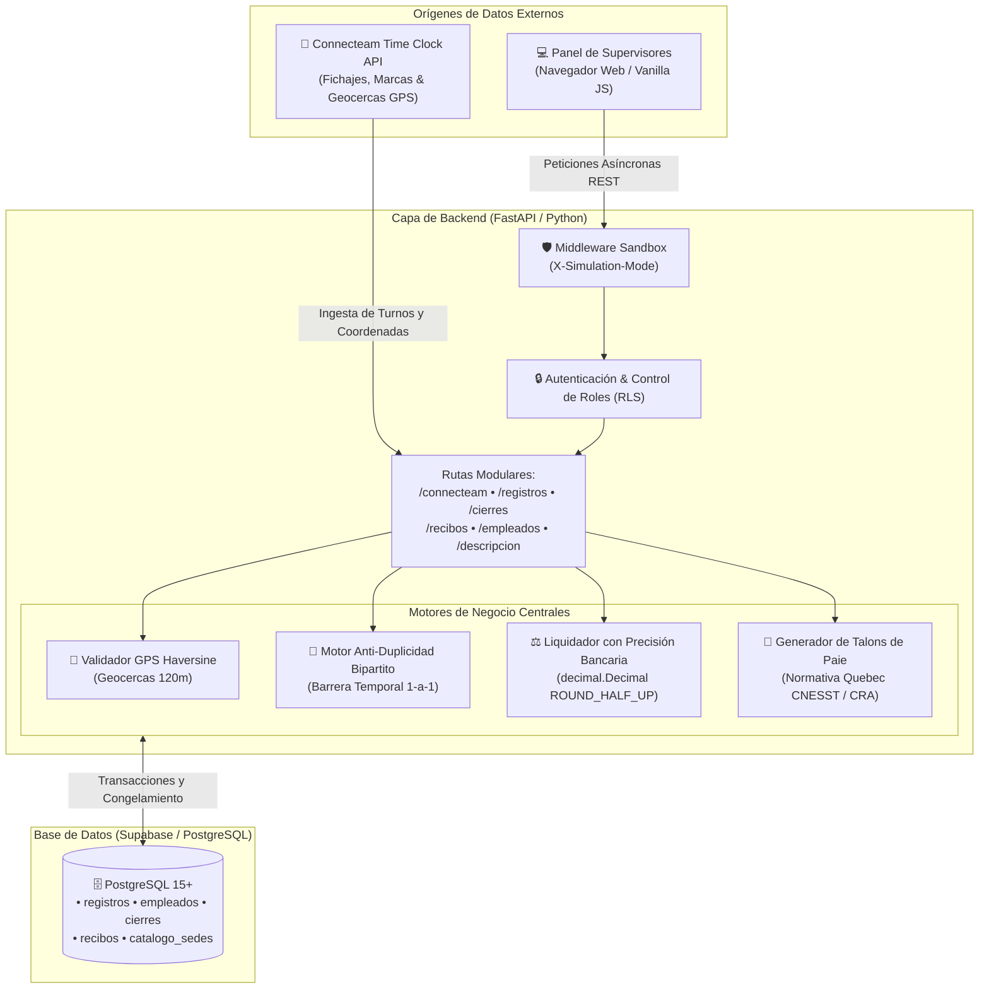

  # 💼 CaroníPay — Sistema de Gestión de Nómina, Asistencia y Supervisión GPS
  ### Solución Empresarial en Producción Activa · Liquidación Contable · Cumplimiento Fiscal y Laboral (Quebec, Canadá)

  

    
    
    
  

  

    
    
    
    
    
    
  

---

> [!NOTE]
> **Aviso de Privacidad y Confidencialidad Comercial:**  
> Este repositorio funciona como **vitrina arquitectónica y demostración técnica pública** de una plataforma real actualmente en uso corporativo. Para proteger la confidencialidad de la empresa cliente, datos de colaboradores y credenciales de infraestructura, el código fuente privado y las bases de datos de producción residen en el repositorio protegido bajo acuerdo de confidencialidad (NDA).

---

## 🌟 Visión General del Proyecto

**CaroníPay (Sistema de Nómina 5.0)** es una plataforma web integral de gestión operativa y liquidación de nómina empresarial diseñada y desarrollada a medida para **Services de Nettoyage Caroní Inc.**, empresa de servicios corporativos y comerciales con sede en **Montreal, Quebec (Canadá)**.

El sistema resuelve la complejidad del control de personal itinerante con turnos fragmentados, dispersión horaria en decenas de sedes de clientes, validación de fichajes mediante geocercas GPS, auditoría anti-duplicidad de marcas de tiempo y generación automatizada de recibos de pago formales en francés (*Talons de paie*) bajo estricto cumplimiento de la normativa fiscal y laboral canadiense.

---

## 🚀 Desafíos Operativos Resueltos

| Desafío Operativo | Solución Implementada en el Sistema |
| :--- | :--- |
| **Turnos Fragmentados y Múltiples Sedes** | Motor multi-tarifa capaz de procesar pagos por hora, montos fijos y tarifas por contrato de visita en un mismo día. |
| **Fraude o Error en Fichajes de Asistencia** | Validación GPS estricta: la sede de trabajo se valida mediante la fórmula de Haversine contra las coordenadas de entrada dentro de una tolerancia de 120 metros. |
| **Colisión y Duplicidad de Turnos Editados** | Motor matemático de correspondencia bipartita 1-a-1 con barrera temporal que evita pisar turnos continuos o re-importar marcas de reloj ya procesadas. |
| **Legislación Laboral de Quebec (CNESST)** | Automatización del Art. 79 de la *Loi sur les normes du travail*: descuento de descanso no remunerado (30 min) condicionado a jornadas continuas $\ge$ 5 horas, aplicado a lo sumo una sola vez al día. |
| **Precisión Financiera sin Fugas de Centavos** | Motor de liquidación aritmética con `decimal.Decimal` en Python y redondeo bancario estándar `ROUND_HALF_UP`. |
| **Emisión Fiscal de Comprobantes (CRA / ARC)** | Generación e impresión de *Talons de Paie* en francés con leyenda legal obligatoria de exención de impuestos TPS/TVH y TVQ para pequeños proveedores. |

---

## 🛠️ Arquitectura del Sistema

---

## 🧩 Módulos Principales de la Plataforma

### 1. 📊 Dashboard Ejecutivo y Métricas en Tiempo Real
- Tarjetas KPI: horas netas laboradas, nómina proyectada, colaboradores activos e incidencias de geolocalización.
- Desglose presupuestario distribuido por sede de cliente y por trabajador.
- Calendario inteligente que calcula automáticamente los desfases contables para sugerir periodos vencidos a liquidar.

### 2. 📍 Sincronización Connecteam y Validación GPS
- Ingesta directa de turnos desde las tarjetas de reloj (*Time Clocks*) de Connecteam vía REST API.
- **Regla estricta de localización:** La ubicación válida del turno se verifica **únicamente con las coordenadas de entrada** (`start.locationData`), descartando discrepancias de salida.
- Cálculo de proximidad por geodistancia complementado con normalización léxica de direcciones cívicas.
- Semáforo de auditoría de tres niveles: `Aprobado Auto`, `Revisión Requerida` y `Alerta de Distancia`.

### 3. 🧩 Motor Anti-Duplicidad Multi-Filtro (Bipartito)
- Diseñado para eliminar colisiones cuando un supervisor edita fichajes manualmente en Connecteam o cuando un empleado realiza turnos sucesivos en la misma jornada:
  - **Barrera de disyunción temporal:** Si dos turnos no tienen solapamiento y su entrada difiere en $> 30$ minutos, el sistema los declara físicamente independientes (`score = 0`).
  - **Algoritmo Bipartito 1-a-1:** Evalúa matrices de combinaciones ordenadas por proximidad; cada registro existente en la base de datos se asocia como máximo a un único turno de entrada.
  - **Protección de datos:** Ejecuta actualización (`UPDATE`) si la confianza es $\ge 60$ puntos, o inserción (`INSERT`) si es una jornada nueva. Los registros congelados quedan protegidos contra escritura.

### 4. ⚖️ Cumplimiento Laboral de Quebec (CNESST Art. 79)
- Deducción de descanso de 30 minutos aplicada de manera no remunerada **únicamente** cuando la jornada continua alcanza o supera las 5 horas continuas ($\ge 300\text{ min}$).
- En jornadas múltiples en una misma fecha, la deducción se aplica a lo sumo una sola vez al turno más extenso, protegiendo los derechos del trabajador.
- Las modalidades por visita o monto fijo quedan exentas por contrato.

### 5. 🔒 Cierres de Periodo y Congelamiento Contable
- Liquidación masiva en lote con selección individual o grupal de colaboradores.
- Una vez efectuado el cierre, las jornadas pasan a estado `congelado = True`, blindándolas ante cualquier intento de sincronización o modificación retroactiva.

### 6. 📄 Emisión de Recibos de Pago (*Talons de Paie*)
- Generación de comprobantes individuales o consolidados en francés bajo formato oficial de Quebec.
- Incorporación mandatoria de la leyenda fiscal canadiense:
  > *"En tant que petit fournisseur au sens de la Loi sur la taxe d'accise, aucune TPS/TVH ni TVQ n'est perçue sur ce montant."*
- Plantillas con vista previa responsiva optimizadas para exportación a PDF e impresión limpia en hoja tamaño carta / A4.

### 7. 🧪 Modo Sandbox / Simulación
- Permite a los administradores activar la cabecera `X-Simulation-Mode: true` para simular cálculos, cierres masivos o reestructuraciones de tarifas sin tocar las tablas de nómina reales de producción.

---

## 💻 Stack Tecnológico Utilizado

| Capa | Tecnología | Propósito |
| :--- | :---: | :--- |
| **Lenguaje Core** | **Python 3.12** | Motor de negocio, parsing de datos y cálculos bancarios |
| **Framework Backend** | **FastAPI 0.115** | API REST asíncrona de alto rendimiento con validación Pydantic v2 |
| **Servidor ASGI** | **Uvicorn 0.34** | Servidor web asíncrono con manejo concurrente de peticiones |
| **Base de Datos** | **Supabase (PostgreSQL 15+)** | Almacenamiento relacional, funciones RPC y Row Level Security (RLS) |
| **Frontend UI** | **Vanilla JS (ES6+) & CSS3** | Interfaz reactiva, rápida y ligera sin sobrecarga de frameworks pesados |
| **Integración Time Clock** | **Connecteam REST API** | Sincronización automatizada de turnos de asistencia y geodatos |
| **Mapas y Geolocalización** | **Leaflet 1.9 / OpenStreetMap** | Visualización interactiva de marcas de fichaje sobre el mapa |
| **Aritmética Financiera** | **Python `decimal.Decimal`** | Precisión matemática bancaria con redondeo `ROUND_HALF_UP` |

---

## 👨‍💻 Autor y Contacto

Desarrollado y mantenido por **DarkYTGG** — Desarrollador de Software & Estudiante de TSU en Informática (5to Semestre).

- 🌐 **GitHub:** [@DarkYTGG](https://github.com/DarkYTGG)
- ✉️ **Correo de Contacto:** [goku.aagl@gmail.com](https://mail.google.com/mail/?view=cm&fs=1&to=goku.aagl@gmail.com)
- 💬 **Otros Proyectos:** [Manhwa AI Translator](https://github.com/DarkYTGG/ManhwaTranslator-App) • [RoosterGenics Plugin](https://github.com/DarkYTGG/RoosterGenics-Plugin)
